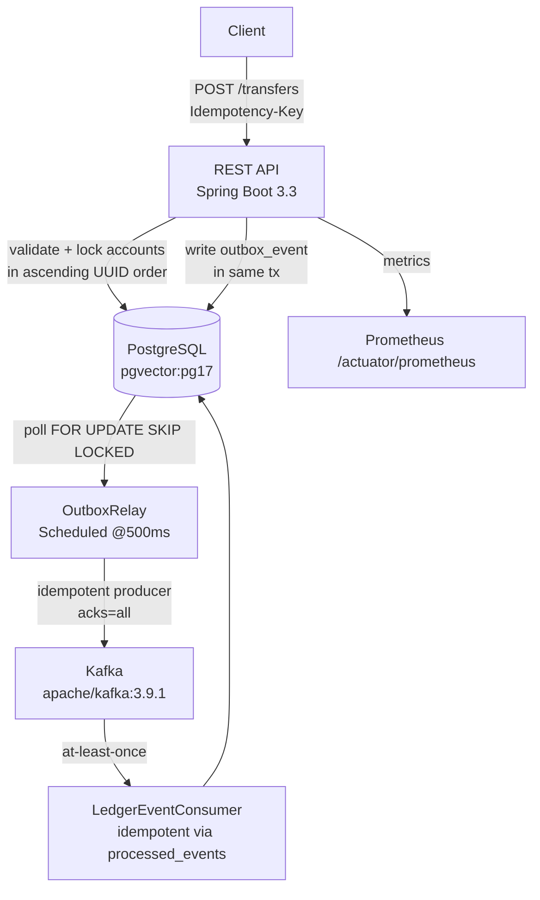

# Payments Ledger

A double-entry accounting ledger built with Java 21 and Spring Boot. Transfers are stored as balanced journal entries in PostgreSQL. An outbox pattern relays events to Kafka so downstream consumers can react without distributed transactions. Virtual threads handle request-level concurrency.

Built to demonstrate idempotency, concurrency correctness, and the outbox pattern — classic interview topics at payments companies (Stripe, Amazon, WEX).

## Architecture



## Quickstart

Requirements: JDK 21, Docker.

```bash
# Build
./mvnw -B package -DskipTests

# Start postgres + kafka + app
docker compose up -d

# Wait for health
curl http://localhost:18200/actuator/health
# {"status":"UP"}

# Create two accounts
ALICE=$(curl -sX POST http://localhost:18200/api/v1/accounts \
  -H 'Content-Type: application/json' \
  -d '{"name":"Alice","currency":"USD","type":"ASSET","allowOverdraft":false}' | jq -r .id)
BOB=$(curl -sX POST http://localhost:18200/api/v1/accounts \
  -H 'Content-Type: application/json' \
  -d '{"name":"Bob","currency":"USD","type":"ASSET","allowOverdraft":false}' | jq -r .id)

# Seed Alice with $500
curl -sX POST http://localhost:18200/api/v1/transfers \
  -H 'Content-Type: application/json' \
  -H 'Idempotency-Key: seed-1' \
  -d "{\"reference\":\"seed\",\"postings\":[
    {\"accountId\":\"$ALICE\",\"direction\":\"CREDIT\",\"amountMinor\":50000,\"currency\":\"USD\"},
    {\"accountId\":\"$BOB\",\"direction\":\"DEBIT\",\"amountMinor\":50000,\"currency\":\"USD\"}
  ]}"

# Transfer $100 from Alice to Bob
curl -sX POST http://localhost:18200/api/v1/transfers \
  -H 'Content-Type: application/json' \
  -H 'Idempotency-Key: txn-unique-001' \
  -d "{\"reference\":\"coffee\",\"postings\":[
    {\"accountId\":\"$ALICE\",\"direction\":\"DEBIT\",\"amountMinor\":10000,\"currency\":\"USD\"},
    {\"accountId\":\"$BOB\",\"direction\":\"CREDIT\",\"amountMinor\":10000,\"currency\":\"USD\"}
  ]}"
# {"id":"...","reference":"coffee","status":"POSTED",...}

# Check Alice's balance (should be 40000 = $400.00)
curl -s http://localhost:18200/api/v1/accounts/$ALICE | jq .balanceMinor
# 40000
```

API docs: http://localhost:18200/swagger-ui/index.html

## Test results

| Test suite | Tests | Status |
|---|---|---|
| Unit (domain rules, property-based) | 11 | All pass |
| Integration (Postgres + Kafka via Testcontainers) | 9 | All pass |
| Concurrency invariant (32 threads × 10 transfers) | 1 | Pass: money conserved, no negative balances |
| **Total** | **21** | **All pass** |

JaCoCo instruction coverage: **54%** (service + domain layer well covered; API controllers not unit-tested).

## Benchmark (laptop, docker compose)

Machine: Windows 11, Docker Desktop (WSL2), Intel i7, 16 GB RAM. Synthetic data, `allowOverdraft=true` to avoid 422s.

| Scenario | VUs | Throughput | p50 | p95 | p99 | Error rate |
|---|---|---|---|---|---|---|
| Spread (low) | 4 | ~50 rps | 13 ms | 25 ms | 40 ms | 0% |
| Spread (high) | 16 | ~125 rps | 35 ms | 98 ms | 150 ms | 0% |
| Hot accounts (contention) | 16 | ~125 rps | 27 ms | 82 ms | 130 ms | 0% |

Caveats: single-node Postgres in Docker; no connection pool tuning; virtual threads enabled but not separately measured against platform threads.

## Design decisions

See [docs/DESIGN.md](docs/DESIGN.md).

## Limitations / what's next

- Coverage is 54%; API layer tests (MockMvc) would raise it.
- API-key auth is simple; real deployments should use OAuth2/mTLS.
- Outbox relay polls every 500ms; Debezium CDC would reduce latency to <100ms.
- Postgres is single-node; for HA add Patroni or use managed RDS.
- No rate limiting or per-key quotas.
- k6 bench uses `allowOverdraft=true` to avoid 422s; a "funded" bench would be more realistic.
- Virtual thread vs platform thread benchmark not done (time constraint).

## License

MIT — Copyright Yashash Mathur
